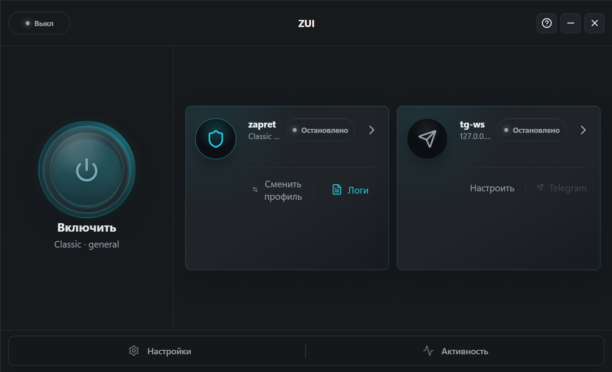
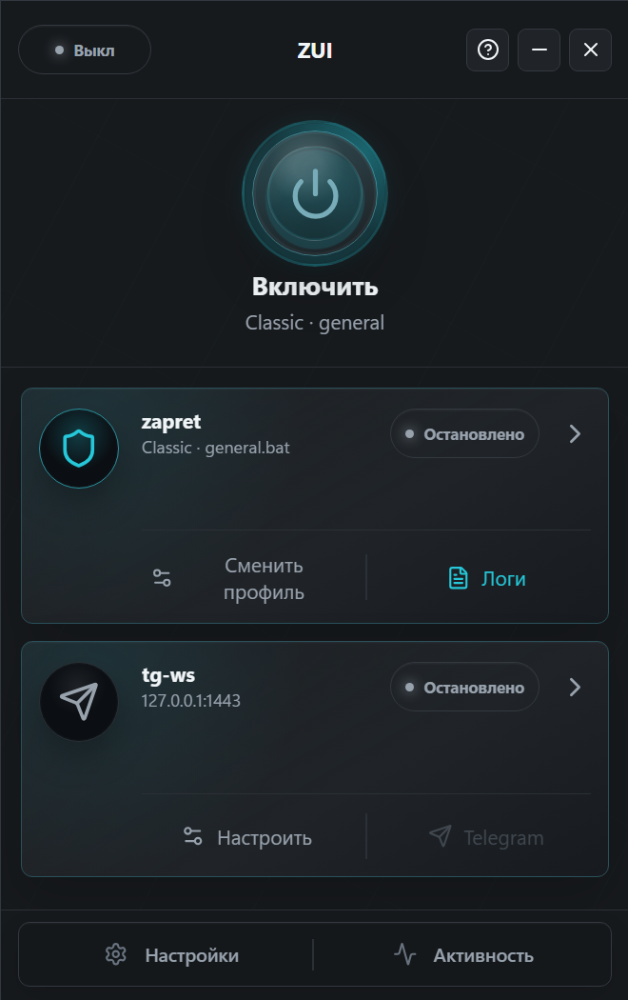
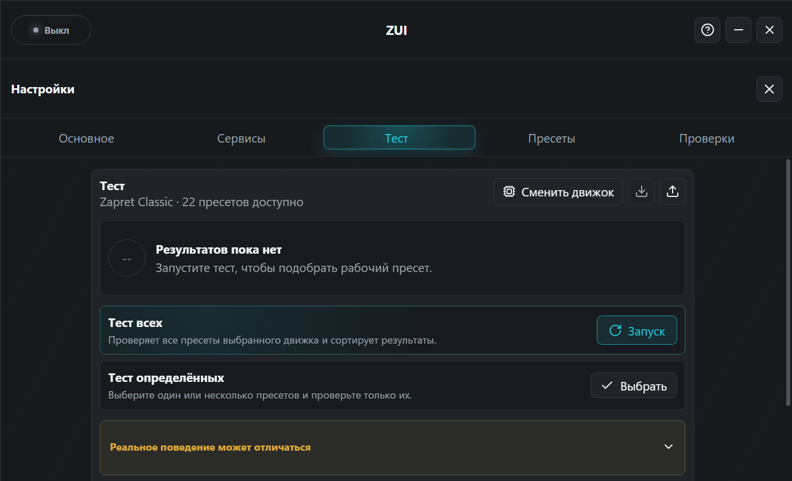
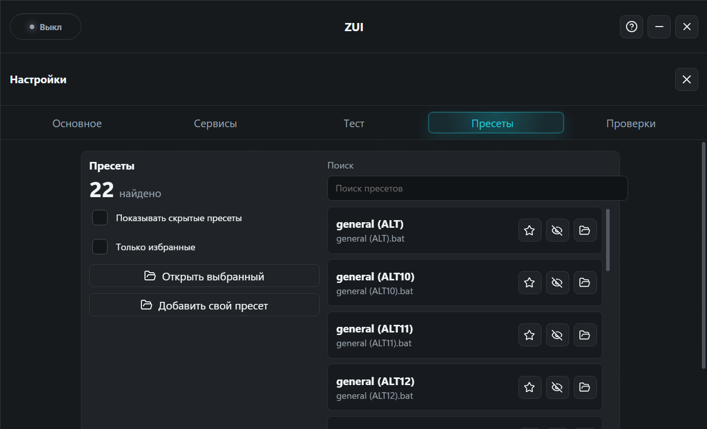
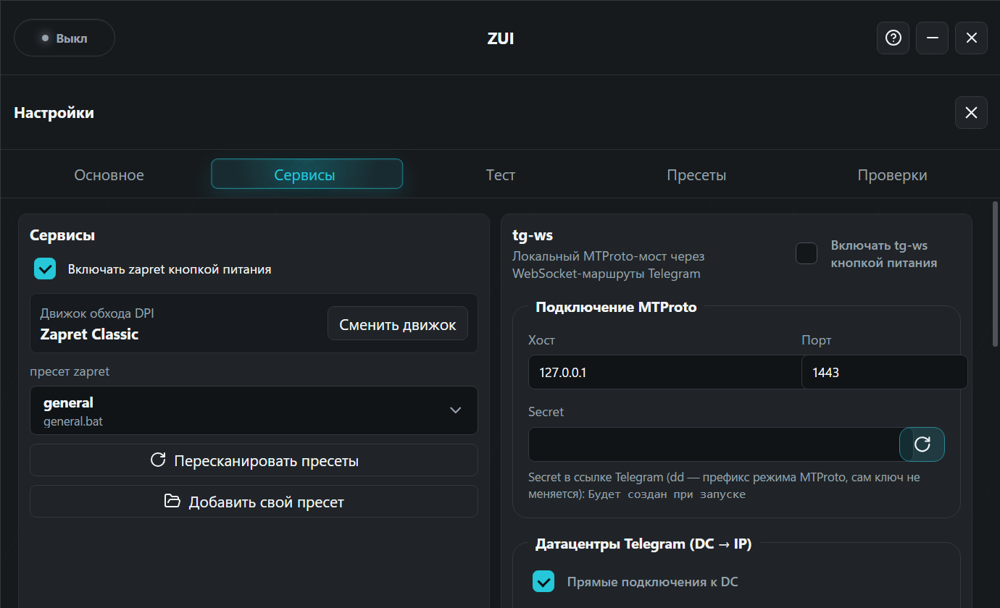
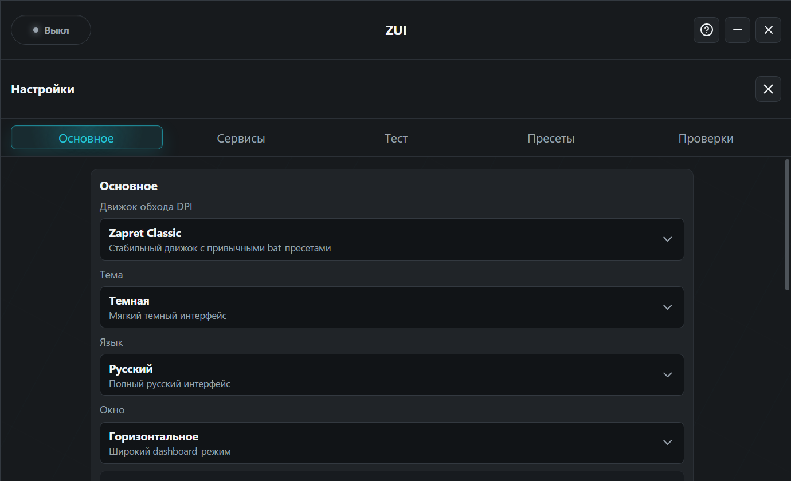

<p align="center">
  
</p>

<h1 align="center">Zapret Universal Interface</h1>

<p align="center">
  <strong>Выбрать пресет. Проверить сеть. Включить zapret и Telegram-прокси.</strong><br>
  Всё в одном приложении для Windows.
</p>

<p align="center">
  <a href="https://github.com/AmantesNihilo/zapret-universal-interface/releases/latest"></a>
  
  <a href="LICENSE"></a>
</p>

<p align="center">
  <a href="#download">Скачать</a> ·
  <a href="#quick-start">Первый запуск</a> ·
  <a href="#interface">Интерфейс</a> ·
  <a href="#network-tests">Проверка сети</a> ·
  <a href="#telegram">Telegram</a> ·
  <a href="#help">Решение проблем</a> ·
  <a href="#development">Разработчикам</a>
</p>

ZUI — графический интерфейс для **zapret Classic**, **zapret 2** и встроенного **tg-ws-прокси**. Он помогает подобрать пресет под вашу сеть, сравнить результаты проверок и управлять сервисами без ручного запуска файлов из папок.

<p align="center">
  
</p>

<p align="center"><sub>Превью интерфейса 2.2.4.</sub></p>

> [!IMPORTANT]
> ZUI и zapret не заменяют VPN: они не меняют ваш IP-адрес и регион и не обеспечивают анонимность. Подходящий пресет зависит от провайдера и сети — универсального варианта для всех подключений нет.

<a id="download"></a>

## Скачать и установить

**[Открыть последний релиз →](https://github.com/AmantesNihilo/zapret-universal-interface/releases/latest)**

В разделе **Assets** выберите один из файлов:

| Файл                             | Когда выбирать                                                                                                                                         |
| ------------------------------------ | ------------------------------------------------------------------------------------------------------------------------------------------------------------------- |
| `ZUI_<версия>_x64-setup.exe` | Обычная установка. Рекомендуемый вариант для большинства пользователей.                              |
| `ZUI_<версия>_portable.zip`  | Запуск из отдельной папки без установки. Распакуйте архив целиком, затем откройте `ZUI.exe`. |
| `ZUI_<версия>_x64_en-US.msi` | Альтернативный установщик в формате MSI.                                                                                            |
| `SHA256SUMS.txt`                   | Контрольные суммы сборок для проверки скачанных файлов.                                                             |

**Требования:** Windows 10/11 x64, Microsoft Edge WebView2 Runtime и права администратора. Текущая сборка запрашивает повышение прав при запуске; они необходимы для работы zapret с WinDivert. Rust и Node.js для готовой сборки не нужны.

Если WebView2 отсутствует, установите [Runtime с сайта Microsoft](https://developer.microsoft.com/microsoft-edge/webview2/). Не переносите один `ZUI.exe` отдельно от ресурсов portable-версии.

<a id="quick-start"></a>

## Первый запуск

1. **Откройте ZUI** и подтвердите запрос прав Windows.
2. Нажмите **«Настроить zapret»** на главном экране. Выберите **Zapret Classic** или **Zapret 2**. Для первого знакомства можно начать с Classic; второй движок проверяется отдельно.
3. В разделе **«Настройки → Тест»** запустите **«Тест всех»** или выберите один либо несколько пресетов через **«Тест определённых»**.
4. Дождитесь завершения, откройте подробности и примените подходящий результат. Если рабочий пресет уже известен, его можно выбрать в **«Настройки → Сервисы»**, пропустив тестирование.
5. На главном экране включите нужные сервисы и нажмите **«Включить»**.
6. Проверьте привычные сценарии: воспроизведение видео, загрузку файла, сообщения и голосовую связь. Сетевой тест помогает с выбором, но не заменяет проверку в самом сервисе.

**Кнопка питания запускает только отмеченные сервисы.** Можно использовать zapret, tg-ws или оба вместе. Для отключения нажмите её повторно.

Перед тестированием остановите другие запущенные экземпляры zapret и похожие средства обхода: они могут мешать запуску и искажать результат. Во время перебора пресетов подключение может кратковременно меняться.

## Что умеет ZUI

| Возможность                                       | Что доступно                                                                                                                                                               |
| ------------------------------------------------------------ | ------------------------------------------------------------------------------------------------------------------------------------------------------------------------------------- |
| **Два движка zapret**                         | Выбор Classic или zapret 2, отдельные пресеты и результаты для каждого движка.                                                     |
| **Подбор пресетов**                      | Тест всех подходящих нескрытых пресетов или выбранного набора, рейтинг и применение результата.     |
| **Подробная диагностика сети** | Сравнение до и после запуска пресета, этап отказа, отдельные протоколы и возможности сервисов.         |
| **Встроенный Telegram-прокси**         | Локальный MTProto-мост, маршруты через WebSocket и Cloudflare, экспериментальный HTTP/2 для медиа.                                |
| **Управление пресетами**            | Поиск, избранное, скрытие и добавление своих папок с Classic-пресетами.                                                           |
| **Диагностика и журналы**           | Проверка прав, наличия движков, выбранного пресета и порта tg-ws; журналы приложения, движка и прокси. |
| **Оформление**                               | Русский и английский языки, тёмная, OLED, светлая и системная темы, акцентные цвета, два режима окна.    |
| **Повседневная работа**              | Управление из трея, настройки автозапуска, проверка обновлений через GitHub Releases.                                      |

<a id="interface"></a>

## Интерфейс

Изображения подготовлены из **Svelte-компонентов версии 2.2.4 в локальном браузерном рендере**. Это превью интерфейса, а не захват окна Windows. Показан демонстрационный профиль: сервисы выключены, реальные секреты не используются, результаты сетевых проверок не имитируются. В desktop-сборке отображение может немного отличаться из-за WebView2, масштаба и выбранной темы.

<details>
<summary><strong>Компактное вертикальное окно</strong></summary>

<p align="center"></p>

</details>

<details>
<summary><strong>Проверка пресетов и настройка целей</strong></summary>



</details>

<details>
<summary><strong>Поиск, избранное и скрытие пресетов</strong></summary>



</details>

<details>
<summary><strong>Настройки сервисов и Telegram-прокси</strong></summary>



</details>

<details>
<summary><strong>Тема, язык и ориентация окна</strong></summary>



</details>

<a id="network-tests"></a>

## Как читать результаты проверки сети

Вкладка **«Тест»** проверяет пресеты выбранного движка. Classic и zapret 2 не смешиваются в одном прогоне.

Сначала ZUI проверяет исходное состояние сети **без запущенного им zapret**, затем запускает пресет и повторяет проверки. Сравнение показывает, что заработало, что было доступно изначально и где возникли ухудшения.

| Проверка                 | Что именно проверяется                                                                                                                                                                         |
| -------------------------------- | ------------------------------------------------------------------------------------------------------------------------------------------------------------------------------------------------------------------ |
| **Discord**                | Web/API, CDN и подключение к Gateway WebSocket с получением ожидаемого Hello.                                                                                                    |
| **YouTube**                | Веб-страница, статические ресурсы и небольшой диапазон медиаданных, если удалось получить пригодный media-адрес.        |
| **DNS**                    | Разрешение имён и DNS-запросы. Доступность DNS-сервера не подменяется одним ping.                                                                        |
| **HTTP и TLS**            | Отдельные HTTP/1.1, HTTP/2, TLS 1.2 и TLS 1.3; проверка ответа, конечного домена и ожидаемого содержимого.                                            |
| **QUIC / HTTP3 readiness** | QUIC-подключение с согласованием `h3`. Это проверка готовности транспорта, а не полноценная загрузка страницы по HTTP/3. |

В подробностях видны этап ошибки, задержка и доступные сведения о согласованном протоколе. Проверки учитывают HTTP-ошибки, неожиданные редиректы, признаки страниц блокировки и CAPTCHA — одного ответа `200 OK` недостаточно.

**Четыре состояния отдельной проверки:**

- **Успешно** — получен ожидаемый ответ.
- **Ошибка** — проверка не пройдена; смотрите этап и причину.
- **Неопределённо** — данных недостаточно, например из-за CAPTCHA или ограничения запросов. Это не обычный провал.
- **Отменено** — проверка не завершена.

Общая оценка учитывает веса и обязательные возможности сервисов, поэтому она **не равна простому проценту зелёных строк**. Для полной оценки YouTube недостаточно открыть главную страницу. Работоспособность Discord voice без авторизованной голосовой сессии не подтверждается: эта проба остаётся неопределённой, токен аккаунта не запрашивается.

Если запущенный тестом `winws` или `winws2` завершён извне, ZUI прекращает тест и сообщает об этом. Не нужно завершать процесс через Диспетчер задач для обычной отмены — используйте **«Стоп»**.

Историю можно экспортировать и импортировать. В версии 2.2.4 хранится **до 100 подробных результатов**; для длительных прогонов сохраняйте нужную историю экспортом. Результаты относятся к сети и моменту проверки, а не обещают постоянную доступность сервисов.

<a id="telegram"></a>

## Telegram-прокси: запуск и возможности

tg-ws встроен в процесс ZUI — отдельный `tg-ws-proxy.exe` и второй значок в трее не нужны. Для его использования не обязательно включать zapret.

1. Откройте **«Настройки → Сервисы»**, найдите блок **tg-ws** и отметьте его включение кнопкой питания.
2. Для Telegram на этом же компьютере оставьте хост `127.0.0.1` и свободный порт, по умолчанию `1443`. ZUI поддерживает создание secret; используйте значение и ссылку, которые показывает приложение.
3. Вернитесь на главный экран и нажмите **«Включить»**.
4. Когда прокси готов, кнопка **«Telegram»** станет доступна. Откройте ссылку и подтвердите подключение в Telegram.

Ссылка с адресом `127.0.0.1` работает на том же компьютере. Для телефона такая ссылка сама по себе не подходит. Secret входит в ссылку подключения — не публикуйте его в Issues или на скриншотах.

<details>
<summary><strong>Расширенные настройки tg-ws</strong></summary>

- **DC → IP** — прямые WebSocket-маршруты к датацентрам Telegram. Их можно отключить переключателем или очистить список; пустой список не восстанавливается автоматически.
- **Cloudflare Proxy** — автоматический список доменов или собственные домены; есть проверка доступности по DC.
- **Cloudflare Worker** — поддержка собственных Worker-доменов и их проверки.
- **Приоритет, балансировка и domain fronting** — дополнительные параметры выбора маршрутов.
- **«Медиа через HTTP/2»** — экспериментальная альтернатива для media-соединений через Cloudflare Proxy. По умолчанию выключена; требует включённого CF Proxy и TLS. Сообщения продолжают использовать обычные маршруты. Более высокая скорость не гарантируется.
- **«Cloudflare без TLS»** — опциональный режим CF Proxy/Worker через порт 80; несовместим с H2. MTProto внутри остаётся зашифрованным, но внешний TLS-слой отсутствует.
- **Буферы, пул соединений и журналирование** — настройки нагрузки и диагностики. Необязательно менять их для первого запуска.

Переключатель прямых DC относится к WebSocket-маршрутам. Резервный raw TCP остаётся отдельным последним маршрутом.

</details>

## Обновление и сохранение настроек

ZUI проверяет последний стабильный релиз GitHub при запуске, если эта настройка включена. Вручную проверку можно запустить в **«Настройки → Основное»**.

**Установленная версия:** приложение может скачать и запустить установщик обновления. Подтверждения Windows выполняет пользователь.

**Portable:** скачайте новый ZIP, закройте ZUI, распакуйте сборку в отдельную папку и перенесите в неё свою папку `data`. Не заменяйте свои настройки пустой `data` из новой сборки. Ресурсы берите из нового архива целиком.

| Режим                                          | Где лежат настройки, результаты и журналы                        |
| --------------------------------------------------- | --------------------------------------------------------------------------------------------------- |
| Установленная версия             | `%APPDATA%\ZUI\`                                                                                  |
| Portable                                            | `data\` рядом с `ZUI.exe`; рядом должен оставаться `portable.flag` |
| Запуск из дерева разработки | `data\` в корне проекта                                                              |

Основные файлы: `settings.json`, `profiles.json`, `preset-preferences.json`, `test-results.json`; журналы находятся в `logs\`. Папка данных может содержать secret прокси и локальные пути — не выкладывайте её целиком. Перед переустановкой или ручным переносом сделайте резервную копию.

<a id="help"></a>

## Если что-то не работает

Начните с **«Настройки → Проверки»**: там видны права, наличие движков, число пресетов, выбранный пресет, порт tg-ws и пути к данным. Журналы доступны через **«Активность»**.

| Симптом                                                                               | Что проверить                                                                                                                                                                                                                                                                        |
| -------------------------------------------------------------------------------------------- | ------------------------------------------------------------------------------------------------------------------------------------------------------------------------------------------------------------------------------------------------------------------------------------------------ |
| **Кнопка питания недоступна**                                   | Настроен ли движок и выбран ли пресет; включён ли хотя бы один сервис; не выполняется ли тест.                                                                                                                        |
| **Не найден `winws.exe` / `winws2.exe`**                                   | Распакован ли весь portable-архив, на месте ли `resources`. Для установленной версии попробуйте повторную установку из официального релиза.                                                |
| **Пресетов нет**                                                            | Выбран ли нужный движок. Нажмите «Пересканировать пресеты» в «Сервисы»; для своей Classic-папки используйте «Добавить свой пресет».                                                     |
| **Пресет не запускается**                                           | Права администратора, журнал движка и другие запущенные экземпляры zapret или конфликтующие приложения.                                                                                                      |
| **Тест показывает ошибку, а сервис открывается** | Откройте подробности: приложение может использовать другой CDN или протокол. Сверьте результат с реальным сценарием; отдельно проверьте DNS, VPN и другие прокси. |
| **Сайт открылся, но видео или голос не работают** | Это разные возможности сервиса. Проверьте media, WebSocket и UDP, затем попробуйте другой пресет.                                                                                                                                |
| **Порт tg-ws занят**                                                          | Выберите другой порт или закройте использующую его программу. После изменения откройте в Telegram новую ссылку.                                                                                           |
| **Telegram не подключается**                                             | Запущен ли tg-ws; актуальны ли порт и secret в Telegram. Проверьте CF-домены/Worker из настроек и журнал tg-ws.                                                                                                                        |
| **Пустое окно или приложение не открывается**      | Наличие WebView2 Runtime, целостность сборки, версию Windows и журналы. Установщик и исходники — разные файлы.                                                                                                             |

Не отключайте защиту Windows целиком ради запуска. Если защитное ПО удалило компонент, проверьте источник сборки, контрольные суммы и само срабатывание перед дальнейшими действиями.

### Сообщить об ошибке

Создайте [GitHub Issue](https://github.com/AmantesNihilo/zapret-universal-interface/issues) и укажите:

- версию ZUI, Windows и тип сборки — installed или portable;
- выбранный движок и название пресета;
- шаги воспроизведения, ожидаемое и фактическое поведение;
- подходящий фрагмент журнала или результат проверки.

В **«Настройки → Проверки → Отчет»** можно подготовить отчёт для поддержки и скопировать его. Он не отправляется автоматически. Перед публикацией просмотрите текст и изображения: уберите secret, ссылки подключения и личные данные.

<a id="development"></a>

## Разработчикам

**Стек:** Tauri 2, Rust, Svelte 5, TypeScript, SvelteKit и Vite. Интерфейс собирается в статические файлы и работает через WebView2; Rust отвечает за процессы, ресурсы, сетевые проверки и встроенный tg-ws.

### Подготовка и запуск

Понадобятся Git, Node.js с npm, Rust stable с MSVC toolchain, Microsoft C++ Build Tools с компонентами для desktop-разработки на C++ и Windows SDK, а также WebView2. Полная инструкция: [Tauri — prerequisites для Windows](https://v2.tauri.app/start/prerequisites/#windows).

Сборка 2.2.4 проверялась с **Node.js 22.23.2**, **npm 10.9.8** и **rustc 1.96.0**. Это проверенное окружение, а не заявленные минимальные версии.

```powershell
git clone https://github.com/AmantesNihilo/zapret-universal-interface.git
cd zapret-universal-interface
npm.cmd ci
npm.cmd run tauri dev
```

`npm.cmd run dev` запускает только frontend. В обычном браузере нет команд Tauri, управления процессами и системного трея — для полноценной работы используйте `tauri dev`. Не запускайте параллельно тестовую и рабочую копии с одними портами и сетевыми процессами.

### Проверки перед изменениями и сборкой

Из корня репозитория:

```powershell
# Типы и Svelte; production-сборка frontend
npm.cmd run check
npm.cmd run build

# Backend приложения
cargo test --manifest-path src-tauri/Cargo.toml --lib
cargo clippy --manifest-path src-tauri/Cargo.toml --lib -- -D warnings

# Встроенный движок Telegram-прокси
cargo test --manifest-path crates/tg-ws-proxy-rs/Cargo.toml
cargo clippy --manifest-path crates/tg-ws-proxy-rs/Cargo.toml --all-targets -- -D warnings
```

Тесты, требующие внешней сети или отдельного нагрузочного прогона, помечены `ignored` и запускаются явно.

### Собрать установщики и portable

```powershell
npm.cmd run tauri build

$version = (Get-Content package.json -Raw | ConvertFrom-Json).version
powershell.exe -NoProfile -File tools/build-release.ps1 -Version $version
```

Tauri создаёт установщики в `src-tauri/target/release/bundle/`. Скрипт упаковки собирает portable, копирует установщики и создаёт `SHA256SUMS.txt` в `release/`.

Для сборки только EXE используйте `npm.cmd run tauri build -- --bundles nsis`, а при упаковке добавьте `-SkipMsi`. Параметр версии скрипта задаёт имена пакетов; версии в `package.json`, Cargo и конфигурации Tauri нужно согласовать **до** компиляции.

### Где что находится

```text
src/app/                    оболочка приложения
src/lib/features/           экраны и логика отдельных возможностей
src/lib/components/         компоненты интерфейса
src/lib/stores/              общее состояние frontend
src/lib/api/                типы, команды и события Tauri
src/lib/shared/             общие утилиты
src/lib/styles/             дизайн-токены и стили
src-tauri/src/              команды, процессы, настройки, диагностика
src-tauri/src/tester/       сетевые пробы, baseline и рейтинг
crates/tg-ws-proxy-rs/      встроенный Rust-движок Telegram-прокси
resources/zapret/           Classic: движок, пресеты и списки
resources/zapret2/          zapret 2: движок, конфигурации, Lua и ресурсы
probe-worker/              опциональный endpoint для протокольных проверок
tools/                     подготовка сборки, упаковка и замеры
docs/                      публичные материалы и изображения для README
```

При добавлении сетевых целей начинайте с [Rust-манифеста](src-tauri/src/tester/manifest.rs): frontend получает встроенные цели через API. Собственный `probe-worker` подключается только при сборке с `ZUI_PROBE_BASE_URL`; без неё приложение не требует вашего Worker. Инструкция — в [probe-worker/README.md](probe-worker/README.md).

## Поддержать проект

Поставьте звезду на GitHub, расскажите о ZUI или помогите воспроизводимым баг-репортом и pull request. Исправления документации и результаты проверок в разных сетях тоже полезны.

<details>
<summary><strong>Поддержать разработку финансово</strong></summary>

| Способ                    | Реквизиты                              |
| ------------------------------- | ----------------------------------------------- |
| Банковская карта | `4377 7278 0187 1414` — Daniil P.            |
| Solana                          | `1hHoDcgWEWF96Yy97hes2gUoSkgANkAE1kNPnJ9Z9Uq` |
| Ethereum                        | `0x7B30eEE5C1625a754915cf761eD7D0DF24A97107`  |
| Bitcoin                         | `bc1qv6x8677487qhkrz50mmx9ymsyagngzfp6fa58j`  |

</details>

## Благодарности и лицензии

ZUI опирается на работу авторов открытых проектов:

- [bol-van/zapret](https://github.com/bol-van/zapret) и [bol-van/zapret2](https://github.com/bol-van/zapret2) — движки обхода DPI.
- [Flowseal/zapret-discord-youtube](https://github.com/Flowseal/zapret-discord-youtube) — Classic-комплект, пресеты и списки.
- [Flowseal/tg-ws-proxy](https://github.com/Flowseal/tg-ws-proxy) — исходный проект и upstream-поведение Telegram-прокси.
- [valnesfjord/tg-ws-proxy-rs](https://github.com/valnesfjord/tg-ws-proxy-rs) — основа встроенного Rust-порта, который развивается в ZUI.
- [klondike0x/zapret2-youtube-discord](https://github.com/klondike0x/zapret2-youtube-discord) — часть набора zapret 2-пресетов.
- [hyperion-cs/dpi-checkers](https://github.com/hyperion-cs/dpi-checkers), Howdyho / DiscordFIX — идеи проверок и наборов целей.

Собственный код ZUI распространяется по [MIT](LICENSE). Включённые движки, WinDivert, библиотеки и пресеты имеют свои лицензии; лицензия ZUI не заменяет их условия.
